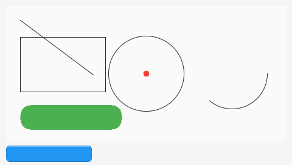
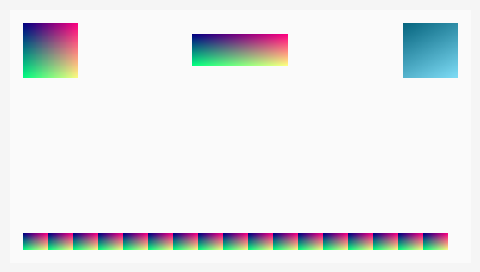
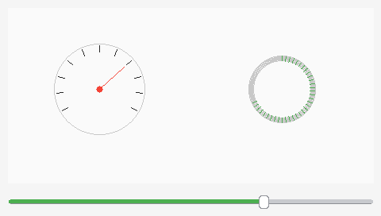
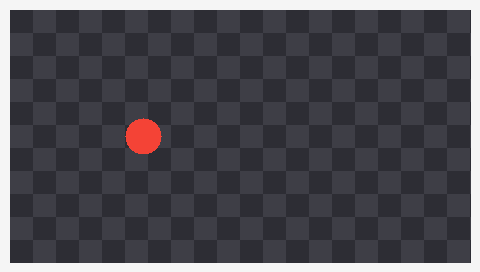
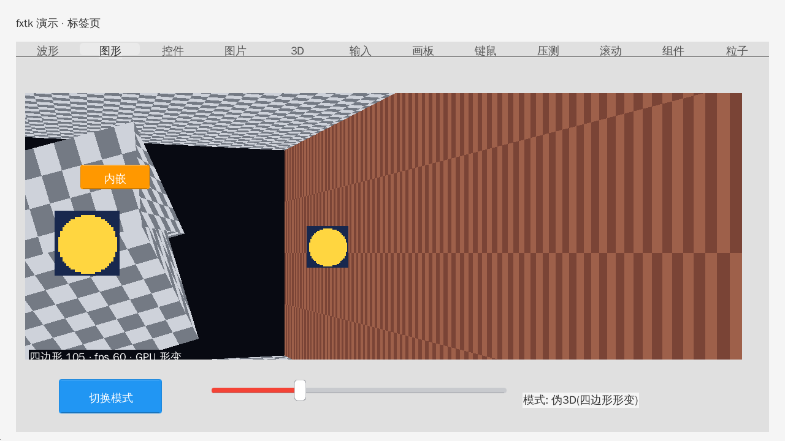
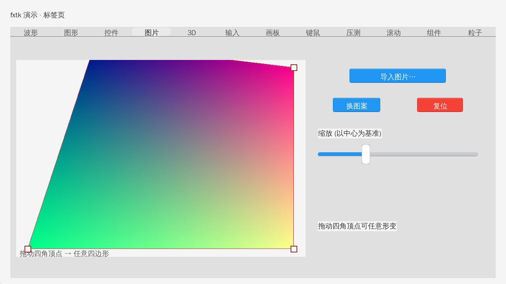
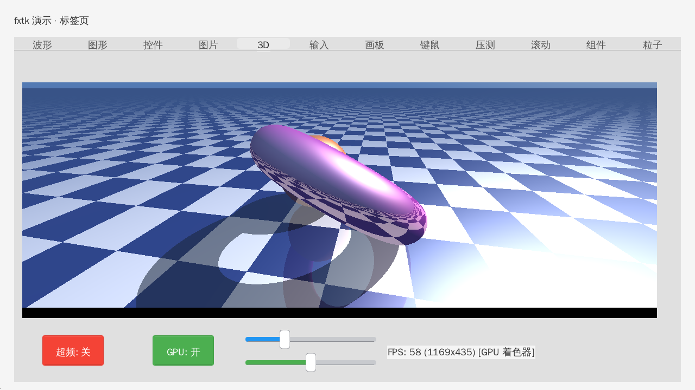
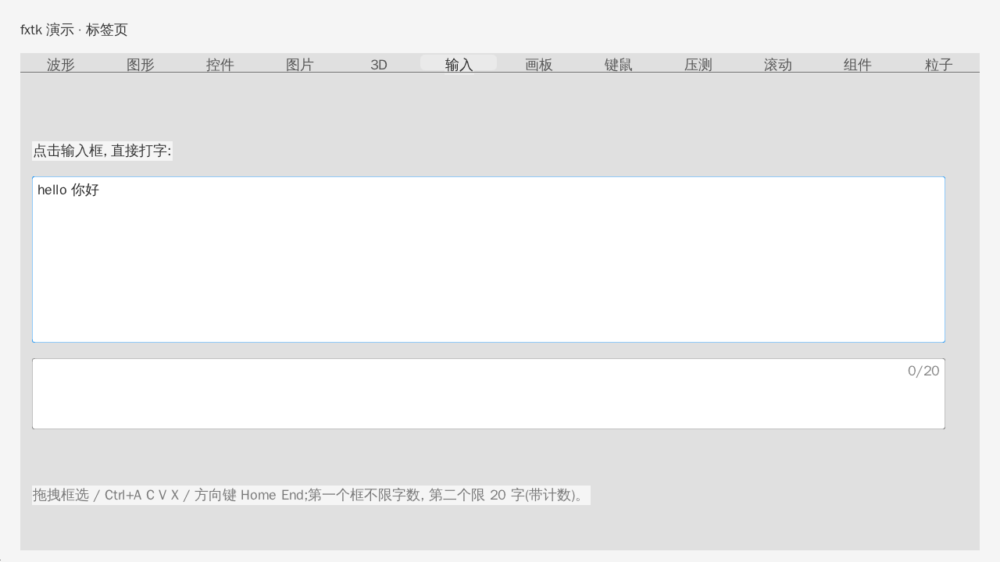
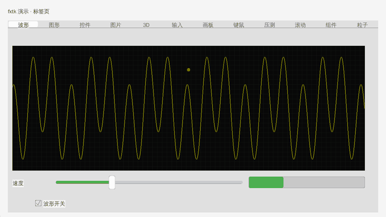

# fxtk — 用属性宏写界面的轻量 C GUI 框架

> **一行一个控件。** 属性宏直接展开成 C99 复合字面量交给编译器，没有 XML、没有代码生成；
> 产物是**单文件、零第三方动态库**的 exe（Linux 377KB / Windows 439KB）。
> 另附**可选 Lua 5.4 绑定**：同一套控件/画布/图片 API 可直接用 Lua 写（`bindings/lua` + `demo-lua/`，
> Lua 源码 vendored，不依赖系统 liblua），C 核心语义不变。

<p>
  
  
  
  
  
  
</p>

> 可当场验证：`cd demo-main && make && ldd ./fxtk_sim` —— `ldd` 里只有 libX11/libGL 等系统库，
> 没有 `SDL2.dll`、没有 `libwinpthread`。
>
> [English README](docs_en/README_en.md)

## 语法：一个控件就是一行

```c
#include "fxtk.h"

/* 回调统一签名: void cb(fx_widget_t *w, void *ud) */
static void on_ok(fx_widget_t *w, void *ud) { (void)ud; fx_set_title(w, "已点击"); }
static void on_canvas(fx_widget_t *w, void *ud) { (void)w; (void)ud; /* 在这里用 fx_* 画 */ }

static void build_ui(void)
{
    fx_label_new   (pixel("16,12","464,40"),   title("设置"));
    fx_button_new  (pixel("16,56","200,96"),   name("ok"),  title("确定"), call(on_ok));
    fx_checkbox_new(pixel("16,108","300,140"), name("chk"), title("启用"), value(1));
    fx_slider_new  (pixel("16,152","380,168"), name("vol"), value(60));
    fx_canvas_new  (pixel("16,184","464,264"), name("cv"),  anim(1), call(on_canvas));   /* 立即模式画布 */
}
```

`pixel("x1,y1","x2,y2")` 用的是**设计稿坐标，不是设备像素**：默认设计稿 480×272，窗口拉多大都等比缩放，
不用自己乘系数。UI 稿是 1280×720 就启动时 `fx_set_design_pixel(1280, 720)`，之后坐标直接按 1280×720 量。

### 四条规则

1. **属性 = `函数名(值)`**，写在构造函数里，顺序无关；同一字段后写覆盖先写。
2. **定位三选一**：`pixel(...)` 设计坐标 / `percent(...)` 父矩形百分比 / `grid(...)` 命名网格切片。
   同时写两种属于未定义风格（最后出现的决定 `pos_mode`）。
3. **回调统一** `void cb(fx_widget_t *w, void *ud)`，`name("ok")` 之后可用 `fx_find("ok")` 拿回控件。
4. **纯 C99**：宏展开成 `(fx_attr_t[]){ ..., FX_ATTR_END }`。没有运行时解析层——
   除了坐标字符串的内容，其他都归 C 编译器管。

### 属性速查

| 类别 | 属性 | 说明 |
|---|---|---|
| 定位 | `pixel(...)` `percent(...)` `grid(...)` | 三选一 |
| 文本 | `title(s)` / `text(s)` | 两者同义 |
| 字号/对齐 | `line(n)` `row(0/1/2)` | `line` 随控件含义不同（标签=字号、网格/页签=行数）；`row`=左/中/右 |
| 样式 | `color(bg)` `fgcolor(fg)` `border(n)` `radius(n)` `dense()` | 不写也有默认配色 |
| 行为 | `name(s)` `call(cb)` `value(n)` `page(n)` `maxlen(n)` `anim(n)` | |
| 页签方位 | `sidebar(FX_TAB_TOP/LEFT/RIGHT/BOTTOM)` | 标签页专用 |
| 其他 | `image(img)` | 图片控件 |

> 边界规则（属性冲突、回调里能不能删控件、`fx_find` 重名、宏展开常见编译错误）：
> **[docs/syntax.md](docs/syntax.md)** —— 写界面之前建议先看这一篇。

### 为什么这样写

- **比结构体初始化短**：不用记几十个字段名和顺序，一行就是界面上的一块。
- **比 XML 方案直接**：核心没有解析器、没有代码生成、没有额外构建步骤；调试器看到的栈就是最终代码。Lua 绑定是可选层，不改变核心这条性质。
- **比立即模式保留更多信息**：控件保留成树，可以 `fx_find` 定位、改属性、走布局；不是每帧重建。
- **代价**：坐标是字符串，写错不会在编译期报错——所以有 `docs/syntax.md` 把边界写死，而不是靠猜。

## Lua 支持：C 核心 + 同构语法

> **C 核心不变**：Lua 只是绑定层，不重写框架、不复制一套控件实现。

- 绑定：`bindings/lua/fxtk_lua.c` 把 `fxtk.h` 的 API 注册成 `fxtk.core`；Lua 5.4 源码 vendored 在
  `third_party/lua/`，**不依赖系统 liblua**。
- 语法层：`lua/fxtk.lua` 提供与 C 属性宏同名的构造函数，`install_globals()` 后可直接逐行照抄 C 写法。
- 演示：`demo-lua/app.lua` 是 12 页完整演示（波形/图形/控件/图片/3D/输入/画板/键鼠/压测/滚动/组件/粒子）。

```lua
require("fxtk").install_globals()

local clicks = 0
local function on_ok(w)
    clicks = clicks + 1
    fx_set_title(fx_find("info"), "点了 " .. clicks .. " 次")
end

function app_init()
    fx_set_bg(FX_WINDOW_BG)
    fx_label_new(percent("0.02,0.01", "0.98,0.09"), title("设置"))
    fx_button_new(pixel("16,56", "200,96"), name("ok"), title("确定"), call(on_ok))
    fx_label_new(pixel("16,104", "300,128"), name("info"), title("点一下试试"))
end
```

```bash
make -C demo-main lua        # 构建通用 runner（核心 + 内嵌 Lua 5.4；脚本不参与编译）
./demo-main/fxtk_lua_runner            # 运行当前目录的 app.lua
./demo-main/fxtk_lua_runner my.lua     # 指定脚本；也可传目录 my_app/ → my_app/app.lua
./demo-main/fxtk_lua                   # 同一程序的兼容名；默认加载 demo-lua/app.lua
FXTK_SCRIPT=my.lua ./demo-main/fxtk_lua_runner
make -C demo-main lua-test   # 无头绑定自检（SDL dummy，无需窗口/字体）
```

脚本是**运行时加载**的：改 `app.lua` 直接重跑 runner 即可，**不用重新编译**；只有改 C 绑定/核心才需要 `make lua`。

- 回调：普通控件 `call(function(w) ... end)`；列表 `fx_list_set_cb(list, function(w, idx) ... end)`
  （下拉在 C 核心内部用 `fx_set_cb`，没有单独的选择回调）。
- C 的多输出参数（`fx_widget_rect` / `fx_canvas_size` / `fx_touch_state`）在 Lua 里直接多返回值。
- 图片/SVG 是带 `__gc` 的 userdata；挂到控件上会被引用住，删控件自动释放引用。
- 详细 API 映射、生命周期、迁移步骤与已知边界：**[docs/lua.md](docs/lua.md)**。

## 一眼看到的样子

画布 / 抗锯齿 / 渐变 / 自定义控件（v2.2 无头渲染示意图，不加载字体，只展示图形与边缘平滑）：

| 抗锯齿 `fx_set_aa(1)` | 渐变 `fx_fill_rect_gradient` | 自定义控件（仪表盘） | 棋盘格（缩放安全） |
|---|---|---|---|
|  |  |  |  |

完整演示（12 页）：控件 / 图片透视形变 / 伪 3D / 输入框 / 文件浏览器 / 粒子 …

   



> 一段真实录制（非渲染动画）：切页 → 图形页的伪 3D 模式 → 图片页拖动四角做真透视形变。

## 体积与依赖

- **Linux 377KB / Windows 439KB 单文件**，`ldd` / `objdump` 里只有系统库；
- 图片解码（PNG/JPEG/BMP/GIF/TGA/PNM）、PNG 截图、剪贴板、文件对话框、随机数、时间、偏好持久化
  **都在框架内**（sokol 与 stb 以源码形式 vendored，不是动态库）；
- 体积裁剪：`-DFXTK_WIDGET_XXX=0` 编译期裁掉不用的控件，`tools/autotrim.sh` 扫源码自动生成开关。

## 能力

| 区域 | 内容 |
|---|---|
| **控件** | 按钮 / 标签 / 滑条 / 进度条 / 复选框 / 网格键盘 / 画布 / 标签页 / 图片 / 输入框 / 列表 / 下拉 / 滚动容器 / 卡片 |
| **布局** | `pixel` 设计坐标 + 响应式缩放 / `percent` / `grid` / 弹性布局（`FX_POS_FLEX`） |
| **画布（立即模式）** | 线/圆/椭圆/三角/多边形/圆弧/圆角矩形/文字/渐变 / 离屏缓冲 / 抗锯齿 / 变换栈 |
| **输入** | 文本编辑（换行、跨行框选、Ctrl+A/C/V/X、系统剪贴板、字数上限）/ 统一滚动（容器·列表·下拉·输入框·画布同一套：滚轮 + 缓动 + 滚动条拖拽）/ 触摸屏拖动滚动（检测到触摸屏才启用，带惯性）/ 焦点管理 / 单指手势 |
| **渲染** | GPU 顶点批 / 真透视四边形形变 / 图像后处理（翻转/灰度/染色/亮度）/ GPU & CPU 光追、粒子 |
| **桌面** | 单窗口置顶/无边框/拖动/居中；多真实窗口（`-DFXTK_MW`，X11/Windows）/ 画布内窗口管理器（`fxtk_wm`） |

## 构建与运行

```bash
# 依赖（默认后端 sokol，不依赖 SDL2）
sudo apt install libx11-dev libxcursor-dev libxi-dev libgl1-mesa-dev

make -C demo-main                 # 12 页演示 fxtk_sim (C)
make -C demo-main lua             # 通用 Lua runner fxtk_lua_runner (脚本运行时加载)
make -C demo-main mw_interactive  # 多真实窗口 + 控件输入闭环 demo
make -C demo-main test            # 无头单元测试（无需窗口/字体）
make -C demo-main lua-test        # Lua 绑定无头自检
make -C demo-main golden          # 画布金图逐像素回归（本地容差 0）
make -C demo-main bench           # 渲染吞吐基准（无头、无 vsync）

make -C demo-main ex01_hello      # 任意独立示例
```

Windows 用 `demo-main/build_win_sokol.sh` 交叉编译出单 exe（CI 会跑）；Lua 版是
`demo-main/build_win_sokol.sh lua` → `dist/win_sokol/fxtk_lua.exe` + `fxtk_lua_runner.exe`（内嵌 Lua，单 exe）。
自己的应用从 [your_app/](your_app/) 开始（`main.c` + `build.sh`，不参与主构建）。

## 验证体系（含边界，如实写）

| 目标 | 覆盖 | 不覆盖 |
|---|---|---|
| `make test` | 真实 OS 服务 + `FXTK_BACKEND_STUB` 确定性变体各跑一遍；布局/命中/控件生命周期/输入/颜色-几何契约；ASan+UBSan 干净 | 假驱动不渲染帧缓冲，**没有逐像素断言** |
| `make lua-test` | C 核心 + Lua 绑定 + 语法层：属性/控件/回调（含列表 index）/画布/图片/列表/flex/SVG/文件/手势 | 无 GPU raymarch、无真实窗口/输入法；**没有逐像素断言** |
| `make golden` | 10 张 canvas 示例金图，本地容差 0 | 只覆盖 canvas，控件/文字/输入框/滚动**没有金图** |
| `make bench` | 1080P 压测页 2820 控件约 102–130 fps（整帧重绘口径） | 合成场景，不代表真实业务 |
| CI | Linux：构建 + 单测 + Lua 绑定自检 + 示例 + canvas 金图（`GOLDEN_TOL=1`）；Windows：交叉编译（含 `fxtk_lua_runner.exe`） | Windows **只编译不运行**；多窗口未进 CI |

**未系统验证**：真实 HiDPI、多显示器、非 ASCII 输入法全链路、跨 WM（GNOME/KWin/xfwm）差异、
极端尺寸窗口、长时间运行内存增长。用前请按自己的环境做回归。

> **AI 参与说明**：本仓库大量代码由 AI 辅助生成（含多窗口后端、部分控件/绘制、文档）。
> “能编译”不等于“边界行为正确”。已有测试/证据的与未验证的都在上表里分开写，不混着说。

## 已知限制

- **整帧重绘**：脏区矩形合并代码存在但当前被旁路（`fx_repaint_rect` 里 `s_full=1`），
  每次请求都是整帧重画 —— 不残影，但没有脏区优化（见 `fxtk.c` 中的注释）。
- **控件层 SDF 抗锯齿**在“画布 + 文字 + quadwarp 混排”下有已知观感缺陷（`fx_set_widget_aa` 可切换/关闭）。
- **多真实窗口**：X11 only（XWayland 可用）、只覆盖主屏、最多 8 窗口、无剪贴板/输入法；
  窗口被系统拖动/缩放时没有事件回调（v2.5.3 起后端会同步客户区尺寸并在下一帧重排/重绘，
  应用可轮询 `fxtk_win_width/height`）；Win32 与 X11 分别实现，行为需各自验证。
- **定位属性是字符串**：`pixel("16,56","200,96")` 写错不会编译报错（没有 `x()/y()/w()/h()` 这类属性）。
- **没有 i18n 层**：英文演示是 `app_en.c` 整份复制，不是运行时切换。
- **没有**无障碍 / RTL / 设计器；坐标用 `int16`，控件池 8192 个上限（可 `-DFX_MAX_WIDGETS` 调）。
- **Lua 绑定是可选层，不改变 C 核心**：回调每次跨语言调用有固定开销；粒子/压测这类热路径在
  Lua 版里做了限流/数量封顶（粒子 4000、压测动态控件 1200）。3D 页在没有 GPU raymarch 钩子的
  宿主上使用 Lua 回退动画，**没有**把 C 的 CPU 光追再移植一份。
  `fx_wm_*`（画布内窗口管理器）、`fx_par_for`/`fx_parallel_for`（C 线程回调）也未绑定，
  这些场景请继续用 C；完整清单见 [docs/lua.md](docs/lua.md)。
- **ESP32 路径已停止支持**（v2.5.3 起）：代码里保留纯 CPU 绘制路径与 `fxtk_backends` 的桩，
  但 CI 与 `make` 目标已移除；`tools/esp32_smoke.sh` 与 `components/fxtk/CMakeLists.txt` 仅作历史存档，
  且清单已过期，不要直接用于 ESP-IDF 构建。

## 目录结构

```
components/fxtk/   框架本体 (fxtk.c/draw/widgets/effects/extra/backends + 头文件；读代码先看这里)
drivers/           后端驱动 (sokol 驱动 + stb 文本层 + 应用外壳；SDL2 驱动只作无头测试/金图用)
your_app/          从这里开始写自己的应用 (main.c + build.sh；不参与主构建)
demo-main/         PC 演示与工具链 (12 页演示 / GPU 光追 / examples / 统一 Makefile)
demo-main/test/    无头单元测试、基准与 Lua 无头宿主 (无需窗口)
bindings/lua/      Lua 绑定 (fxtk_lua.c/.h；把 fxtk.h API 注册成 fxtk.core)
lua/               Lua 语法层 (fxtk.lua；与 C 属性宏同构的构造函数 + install_globals)
demo-lua/          Lua 版 12 页演示 (app.lua) 与最小示例 (hello.lua)
examples/          独立示例 ex01~ex18
examples/canvas/   画布学习教程 (canvas_01 ~ canvas_10)
third_party/       vendored 依赖 (sokol 头文件；stb 在 components/fxtk/vendor；Lua 5.4 源码在 third_party/lua)
docs/              中文文档 (quickstart / guide / api / syntax / desktop / effects / internals / backends / lua)
docs_en/           英文文档
test/golden/       金图回归参考图 (逐像素比对)
tools/             开发工具 (autotrim / golden / package_release / check_api_docs)
.github/           CI (Linux 构建 + 测试 + 金图；Windows 交叉编译)
CHANGELOG.md       按版本记录变更 (含根因与实测数字)
```

## 文档

- **[docs/syntax.md](docs/syntax.md)** — 属性/回调/布局优先级/命名规则（**写界面先看这篇**）
- [docs/quickstart.md](docs/quickstart.md) — 5 分钟跑通
- [docs/guide.md](docs/guide.md) — 从零到精通完整教程
- [docs/api.md](docs/api.md) — API 速查表
- [docs/desktop.md](docs/desktop.md) — 桌面演示验收点
- [docs/effects.md](docs/effects.md) — 图片/特效说明
- [docs/examples.md](docs/examples.md) — 示例导读
- **[docs/lua.md](docs/lua.md)** — Lua 绑定：构建、API 映射、生命周期、迁移与边界
- [docs/internals.md](docs/internals.md) — 内部机制（面向源码修改）
- [docs/backends.md](docs/backends.md) — 后端服务层
- [docs/windows.md](docs/windows.md) — Windows 编译
- [docs/multi-window.md](docs/multi-window.md) — 多真实窗口后端（FXTK_MW）
- [docs/window-manager.md](docs/window-manager.md) — 画布内窗口管理器（fxtk_wm）

## 后端策略

sokol（OpenGL）是默认且唯一在演进的 PC 后端；SDL2 只保留给无头测试/基准/金图（`SDL_VIDEODRIVER=dummy`），
发布产物一律走 sokol —— Windows 因此能做到单 exe 无第三方 DLL。

## 发布

```bash
cd demo-main && make package     # 或 ../tools/package_release.sh
# → dist/pkg/fxtk-<版本>-src.tar.gz        纯源码
#   dist/pkg/fxtk-<版本>-linux-x86_64.tar.gz
#   dist/pkg/fxtk-<版本>-win-x86_64.zip
#   dist/pkg/fxtk-<版本>-linux-shared.tar.gz
```

## 许可

MIT（示例与文档同许可）。第三方 vendored 源码的许可见各文件头部。
