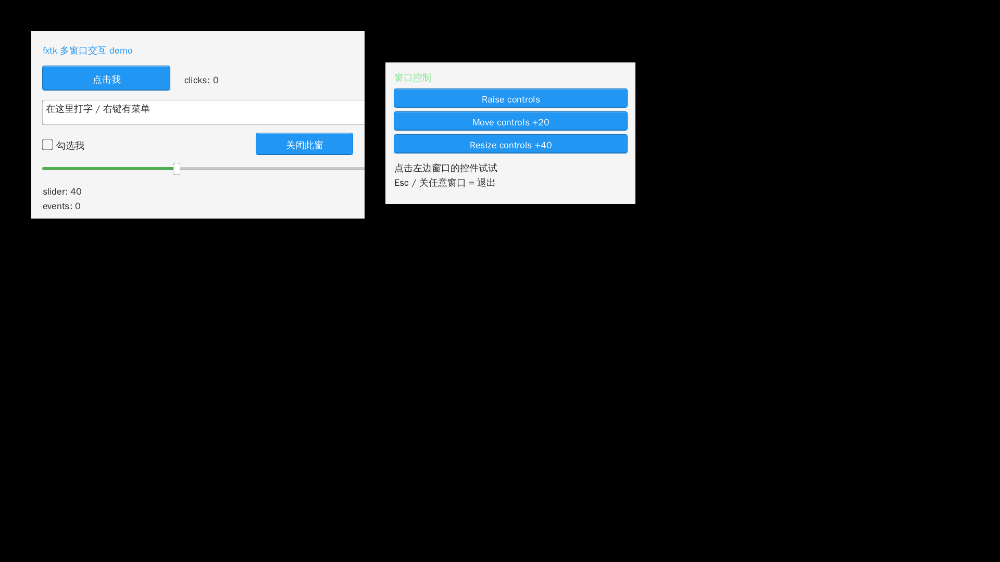

# 多真实窗口（FXTK_MW）— 设计、接口与维护

> 状态：已合并 main，**v2.5.2 起鼠标/键盘事件会转发给控件层**（每窗一棵独立控件树），并带一个可交互 demo。
> 默认后端仍是单窗口 sokol_app；多窗口是 `drivers/` 里**换掉平台层**的第二个后端，不影响现有单窗口路径与体积。
> 参考实现：MV 仓库 `mv/pv/v2/single/movie.c`（6 窗、212s 渲染压测）；
> 交互参考：[examples/mw_interactive.c](../examples/mw_interactive.c)（按钮/滑杆/文本框/右键菜单/窗口控制）。

## 1. 它解决什么

sokol_app 是单窗口设计（全局状态 + 一次 `sapp_run`），做不了真正的多窗口。
本分支提供 **一个进程、一个 GL 上下文、N 个原生窗口** 的后端：

- 应用只包含 `fxtk.h` + `fxtk_win.h`，**不碰 X11/Win32/sokol**；
- 后端实现一个 vtable（`fxtk_win_backend`），Windows 走 WGL、Linux 走 GLX；
- 每个窗口有自己的画布/帧缓冲（尺寸可不同），每帧逐个窗口 `make_current → 画 → SwapBuffers`。

## 2. 文件与职责

| 路径 | 职责 |
|---|---|
| `drivers/fxtk_win.h/.c` | 后端无关 façade：注册 vtable、窗口生命周期、尺寸/位置/标题、屏幕尺寸、客户区偏移 |
| `drivers/fxtk_sokol_mw.c` | 多窗口后端实现（X11 GLX + Win32 WGL） |
| `drivers/fxtk_mw.h` | 后端内部接口（`fxtk_mw_register()`、窗口操作、屏幕尺寸、客户区偏移） |
| `drivers/fxtk_mw_gl.c` | 单窗口 GL 入口（上下文/交换链工具） |
| `drivers/fxtk_sokol_driver.c` | fxtk 的 sokol 驱动；`FXTK_MW` 分支下支持每窗口画布/帧缓冲缓存 |

## 3. 编译

应用统一加 `-DFXTK_MW`；Windows 需要 `-DSOKOL_GLCORE`。

Linux：

    gcc -DFXTK_MW -O2 app.c \
        drivers/fxtk_sokol_mw.c drivers/fxtk_sokol_driver.c \
        drivers/fxtk_font_stb.c drivers/fxtk_win.c components/fxtk/*.c \
        -Icomponents/fxtk -Idrivers -Ithird_party/sokol \
        -o app -lX11 -lXi -lXcursor -lGL -ldl -lpthread -lm

Windows（MinGW-w64；Linux 上交叉编译同理加前缀）：

    x86_64-w64-mingw32-gcc -DFXTK_MW -DSOKOL_GLCORE -O2 app.c \
        drivers/fxtk_sokol_mw.c drivers/fxtk_sokol_driver.c \
        drivers/fxtk_font_stb.c drivers/fxtk_win.c components/fxtk/*.c \
        -Icomponents/fxtk -Idrivers -Ithird_party/sokol \
        -o app.exe \
        -lopengl32 -lgdi32 -luser32 -lole32 -loleaut32 -luuid -lshell32 -lwinmm -mwindows

## 4. 应用侧 API（`fxtk_win.h`）

| API | 说明 |
|---|---|
| `fxtk_win_init() / shutdown` | 初始化/关闭当前后端 |
| `fxtk_win_create(w,h,x,y,title)` | 创建窗口，返回 id（失败 -1） |
| `fxtk_win_create_ex(..., flags)` | 带标志创建；`FXTK_WIN_BORDERLESS` = 无边框 |
| `fxtk_win_show(id,on) / raise / move / resize / title` | 窗口生命周期与几何 |
| `fxtk_win_begin(id) / end(id)` | 该窗口一帧的绘制区间（begin 设当前 GL 上下文/尺寸，end 合成并 present） |
| `fxtk_win_width/height` | 客户区像素尺寸 |
| `fxtk_win_poll() / quit() / time()` | 事件轮询、退出查询、单调时间 |
| `fxtk_win_screen(&w,&h)` | 屏幕像素尺寸（应用用来把 1280×720 舞台居中/等比缩放） |
| `fxtk_win_client_offset(id,&ox,&oy)` | 客户区相对外框偏移（Win32 需要；X11 为 0） |

最小流程：

    fxtk_mw_register();                 // 平台外壳注册后端（fxtk_mw.h）
    fxtk_win_init();
    int w1 = fxtk_win_create(640,300, 30,30, "notes");
    int w2 = fxtk_win_create(1200,80, 40,600, "player");
    for (;;) {
        fxtk_win_poll();
        if (fxtk_win_quit()) break;
        fxtk_win_begin(w1);  /* fxtk 绘制 */  fxtk_win_end(w1);
        fxtk_win_begin(w2);  /* fxtk 绘制 */  fxtk_win_end(w2);
    }

要点：

- 绘制坐标是**窗口客户区逻辑像素**；窗口尺寸不同完全没问题（每窗口独立画布）。
- 关闭任意窗口（或按 Esc）= 退出整个程序；如需"关某个窗口不退出"，要改后端 `s_quit` 语义。
- 标题是 UTF-8：Win32 内部转 UTF-16（`CreateWindowExW` + `DefWindowProcW`），X11 写 `_NET_WM_NAME`。
- **应用坐标 ≠ 外框坐标**：`fxtk_win_move` 传的是窗口外框位置；想对齐"客户区"用
  `fxtk_win_client_offset` 自行扣掉（Win32 标题栏约 30–40px，X11 由 WM 处理、偏移返回 0）。

### 4.1 多窗口里的控件 UI（v2.5.2）

核心控件层原本只有一棵全局根。多窗口下给每扇窗建一棵独立根，并在该窗口的 begin/end 之间调 `fx_poll()`：

```c
static fx_widget_t *roots[2];
/* 建窗后: */
roots[0] = fx_root_new();
fx_root_select(roots[0]); fx_parent(roots[0]);
fx_button_new(pixel("16,50","200,86"), title("点击我"), call(on_click));

/* 每帧: */
while (!fxtk_win_quit()) {
    fxtk_win_poll();                       /* 收原生事件(按窗口暂存) */
    for (int i = 0; i < 2; i++) {
        fxtk_win_begin(win[i]);            /* 切 GL 上下文/尺寸, 并把本窗事件投给驱动 */
        fx_root_select(roots[i]);          /* 切控件树 */
        fx_repaint();                      /* demo 用整窗重绘; 可按需改脏区 */
        fx_poll();                         /* 处理输入 + 布局 + 绘制 */
        fxtk_win_end(win[i]);              /* 合成 + SwapBuffers */
    }
    fx_sleep_ms(8);
}
```

输入链路：原生事件 → 后端按窗口排队 → `b_begin` 投递 → 驱动队列 → `fx_poll` → 控件层；
文本输入(WM_CHAR / XLookupString)、Ctrl+C/V/X/A/L、右键菜单、滚轮都在这个链路上。

一键构建/运行：

    make -C demo-main mw_interactive && ./demo-main/mw_interactive



## 5. 后端实现要点（维护者看）

- 一进程一 GL 上下文；每个窗口 `CreateWindow` + 同一个 pixel format，渲染前 `make_current`。
- 每窗口 canvas/framebuffer 按**尺寸**缓存（24 槽）。v2.5.3 起缓存满时按 LRU 淘汰（同时释放
  帧缓冲/纹理），因此用户拖拽窗口连续缩放不会泄漏或撑爆缓存；仍不建议应用**每帧**改尺寸
  （每帧换一个新尺寸会一直走淘汰路径，浪费带宽）。
- **必须关 vsync**：N 个窗口串行 `SwapBuffers`，若开 vsync 会互相等垂直同步，帧率掉到
  `60/N`；帧率由应用自己的 fps 上限控制。
- 窗口事件走原生 API：Win32 `PeekMessageW/DispatchMessageW`（`WM_CLOSE`/`WM_DESTROY`/ESC）；
  X11 `XPending/XNextEvent`（`WM_DELETE_WINDOW`/DestroyNotify/ESC）。
- 已知限制（如实写）：
  - **X11 only**，未做 Wayland；
  - 只覆盖主屏，未处理多显示器；
  - 最大窗口数 `FXTK_MW_MAX = 8`；
  - 真 HiDPI 未验证（沿用 DPI-unaware + 系统缩放）；
  - 没有窗口图标/最小化状态/每窗口独立消息回调；
  - **剪贴板在 MW 下未实现**（右键菜单"粘贴/复制"目前是空操作）；中文输入法(IME)在 sokol/MW 路径同样未接；
  - 窗口被用户拖动/缩放后**没有事件回调**；v2.5.3 起后端会同步客户区尺寸，下一帧自动重排/重绘，
    应用可轮询 `fxtk_win_width/height` 取新尺寸（此前不处理 ConfigureNotify/WM_SIZE，放大后内容
    会缩在左下角、其余区域全黑）。窗口被移动(x/y)不触发重绘。

## 6. 验证

- **交互闭环**：`make -C demo-main mw_interactive` 后运行；已验证（Xvfb + xdotool 自动化）：
  按钮点击、复选框、滑杆拖动、文本框键盘输入（ASCII）、右键菜单、窗口 raise/move/resize；
- MV 用例：`mv/pv/v2/single/`，6 窗口渲染 + 全片 212s（窗口缩放/移动/闪白），验证渲染与后端稳定性；
- 冒烟：多窗口标题栏/内容正常、关任意窗退出、连续 resize 不闪/不崩；
- **外部缩放**（v2.5.3）：Xvfb + xdotool 把窗口从 640x360 连改 40 个尺寸后回到原尺寸，内容始终铺满、
  无黑带、缓存复用正常；应用侧 `fxtk_win_resize` 路径同样复测；
- 已知坑/回归命令见 MV 仓库 `mv/pv/v2/single/MAINTENANCE.md` 第 5、6 节。

## 附：与画布内窗口管理器（`fxtk_wm`）的区别

- 本文件 = **系统真实窗口**（一进程 N 原生窗口，OS 标题栏/任务栏/焦点）；
- `fxtk_wm` = **单窗口内画出来的窗口**（自绘标题栏/边框/合成，不占系统窗口）；
  需要"看起来像窗口"而不是"真的是窗口"时用它，见 [window-manager.md](window-manager.md)。

